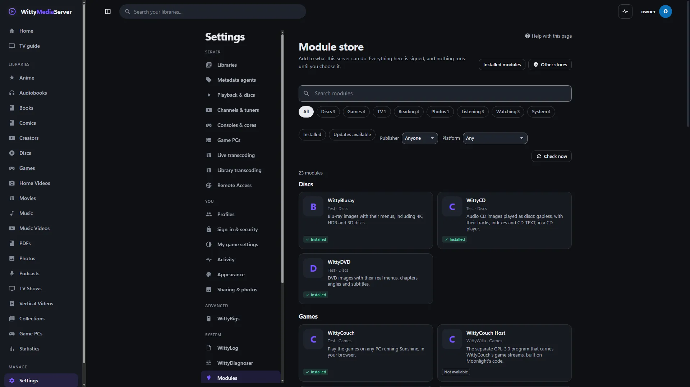
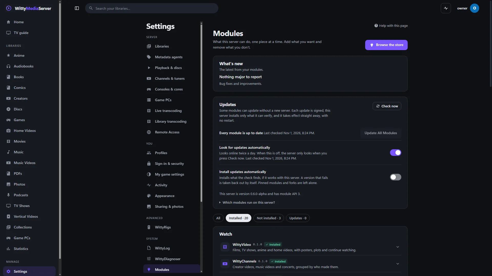

# WittyModuleCatalog

The list of modules a WittyMediaServer can install: one signed file, `catalog.json`, saying which modules exist, every version of each, what each is for, what it asks for, which servers it fits and where its files are. You read it through the store in the app. You only need this repository to list a module.

<!-- pictures -->



<sub>What a server makes of this list: its store, here from a local test catalogue.</sub>



<sub>Settings, Modules, in WittyMediaServer.</sub>

<!-- /pictures -->

## What it does

A server's store reads this list. Modules stay in their own repositories, and this one holds none of their code.

The catalogue only **offers**. What runs is decided by the signed checksum list and manifest in each module's own release, and an install is refused if they disagree with the catalogue. So this repository can't make anything run on anyone's server, and its signature doesn't vouch for more than the list.

## How to get it

You don't fetch it by hand. A server's store reads it in **Settings → Modules**, which needs WittyMediaServer 0.6.0-alpha or later, and nothing older.

It's published at `https://github.com/wittywilla/WittyModuleCatalog/releases/download/catalog/catalog.json`, with `catalog.json.sig` and the module icons beside it. They're replaced whenever `catalog.json` or an icon changes on `main`.

## What it needs

Nothing to read. To change it:

- Go, for the `wittymodule` tool in [WittyModule](https://github.com/wittywilla/WittyModule), whose `Catalog` is the code that reads and checks this file.
- Node.js, for the icon script.

## Platforms

There's no program here: the file is the same for a server on any system. The scripts are run on Linux by the GitHub workflows, and those have not run yet.

## Building and testing

CI checks the file and the icons:

```bash
go run github.com/wittywilla/wittymodule/cmd/wittymodule catalog-check catalog.json
```

```bash
node scripts/make-icons.mjs --check
```

```bash
node scripts/check-api.mjs catalog.json
```

`check-api.mjs` checks what `catalog-check` leaves to the server: that every version's module API is one a server takes (3 or 4 today), that a version built for API 4 names a `minServer` that reads `sdui.json`, and that a version's `status` is one a server knows, with the `statusNote` an unfinished one needs. It also notes which modules have no version for the newest server yet, and which API-4 versions have no `ui` summary.

**How it changes.** `scripts/refresh.sh` looks at every listed module's GitHub releases and adds any version not yet listed, once that release's signature checks out. The **refresh** workflow runs it four times a day, and when asked from the Actions tab. **publish** then signs the new file and puts it on the `catalog` release.

**To list a new module,** add it to `catalog.json` by hand with `"versions": []` and raise `serial`, or run:

```bash
go run github.com/wittywilla/wittymodule/cmd/wittymodule catalog-add -catalog catalog.json -pub <module public key> <folder of its release files>
```

Versions are never edited after they're listed. To take one back, set `withdrawn` on it, as well as using the withdraw workflow in the module's own repository, and raise `serial`.

**Icons.** Each module's icon is `icons/<id>.png`, drawn by `scripts/make-icons.mjs`: a rounded square in its category's colour with one simple white mark. Never a console's, disc format's, service's or anyone else's logo.

`node scripts/make-icons.mjs` draws them all and writes each one's size and SHA-256 into `catalog.json`, and `--check` fails if the two disagree. A new module needs a mark added to that script first, and an icon that changes needs `serial` raised.

In `catalog.json` an icon's `url` is only its file name. The catalogue's addresses are relative to the catalogue itself, and a GitHub release can't hold folders, so **publish** uploads the icons flat beside `catalog.json`. An icon isn't signed on its own: the signed catalogue gives its SHA-256.

The format is described in Making a module, in **Help** inside WittyMediaServer.

## Module API 4: every version carries sdui.json

From module API 4, a module carries its own server-driven UI: `sdui.json`, beside `module.json` in its repository and at the root of every archive of a release (`wittymodule pack` puts it there). It holds what the module adds to every app: its pages, rows on the built-in pages, components, data sources, menu entries, settings and its theme scope. The server checks it against its own catalogue of components when the module is installed and before every use, and refuses a version built for API 4 that has none. WittyMediaServer's `docs/SDUI-MODULES.md` describes the file, and WittyModule's SDUI kit (`sdui/` for Go, `kit/sdui/` for web bundles) writes and checks it.

Nothing about this changes the catalogue's own format. A server from 0.8.0-alpha takes module API 3 and 4, so every version listed for API 3 stays valid and installable where its `minServer` and `maxServer` allow; nothing listed needs editing, and versions are never edited anyway.

**What an entry for an API-4 version needs.** It is listed the usual way, by `scripts/refresh.sh` or `catalog-add`, from a signed release, and these fields come from that release's `module.json`, which an install checks them against:

| Field | For an API-4 version |
|---|---|
| `api` | `4` |
| `minServer` | `0.8.0-alpha` or later: the first server that reads `sdui.json`. `check-api.mjs` refuses an earlier one. |
| `maxServer` | The newest series it was tested with, such as `0.8.x`. |
| `delivery` | `helper`, `program` or `web` need `sdui.json`. A `library` (such as WittyDisc) is never installed on its own and carries none. |
| `license` | `AGPL-3.0-or-later` for the project's own modules. |
| `platforms` | Every archive holds `sdui.json` at its root, covered by the release's signed checksum list like every other file. The catalogue doesn't name it: the server reads it from the installed version's folder. |
| `status`, `statusNote` | Copied from the manifest, when it says them. See below. |
| `ui` | A summary of its `sdui.json`, written by `catalog-add`. See below. |

Before listing one, check the release with the WittyModule that speaks API 4 (`wittymodule check` on the module's folder requires and checks `sdui.json`). `catalog-check` and `catalog-add` read only the catalogue and the signed manifest, so they work the same for API 3 and 4. The workflows here run them from WittyModule v0.3.0; move that pin, in `ci.yml`, `publish.yml` and `scripts/refresh.sh`, to WittyModule's first release with module API 4 once it is published. The numbers in `check-api.mjs` are raised in the same change as the first version of a newer API.

## How finished a version is, and what it adds: `status` and `ui`

From module API 4 a version can say how finished it is, and its entry here says the same, so the store can warn before anything is downloaded. Both are written by `wittymodule catalog-add` from the signed release; nobody types them in by hand. The full rules are in WittyModule's [specification](https://github.com/wittywilla/WittyModule/blob/main/docs/SPEC.md), sections 4 and 18.

| Field | What it is |
|---|---|
| `status` | `stable` (the same as leaving it out), `beta`, `experimental` or `incomplete`, from the release's `module.json`. |
| `statusNote` | One line of plain text, at most 500 characters: what isn't done or may break. **Required** when `status` is `experimental` or `incomplete`, and shown to an administrator before they agree to install it. |
| `ui` | What the version's `sdui.json` adds to the apps: `pages` (`[{id, title}]`, at most 32, titles of at most 120 characters), `navigation` (the menu entries' labels, at most 16 of at most 40 characters), `settings` (whether it describes settings), `sources` and `inserts` (how many). `catalog-add` reads it from the `sdui.json` inside the signed archive, checked against the signed list. |

```json
{
  "version": "0.4.0",
  "delivery": "helper",
  "api": 4,
  "minServer": "0.8.0-alpha",
  "maxServer": "0.8.x",
  "status": "incomplete",
  "statusNote": "No settings page yet; the shelf on Home is the only way in.",
  "ui": { "pages": [{ "id": "wittyphotos", "title": "Photos" }], "navigation": ["Photos"], "settings": false, "sources": 1, "inserts": 1 }
}
```

A server goes by the release itself, never by these copies: it reads the status from the signed manifest it downloads, and installs an `experimental` or `incomplete` version only after an administrator reads the note and agrees. So an entry's `status` can't make a version look more finished than it is, and leaving `status` out of an entry hides nothing.

`check-api.mjs` refuses a status a server doesn't know, and an `experimental` or `incomplete` version without a note. A reader that doesn't know these fields ignores them, so the catalogue's format stays 1, and `catalog-check` from WittyModule v0.3.0 (what CI pins) still passes. That version of `catalog-add` doesn't write them, though, so an API-4 version listed with it has no `ui` and no `status` until the pin moves to the first WittyModule release that writes them; `check-api.mjs` notes such versions.

## Licence

GNU Affero General Public License v3.0 (or later): see [LICENSE](LICENSE) and [NOTICE](NOTICE). If you redistribute it or build on it, please keep the NOTICE attribution. The icons are drawn by the script here.

## Legal

WittyModuleCatalog is an independent open-source project. It isn't associated with, sponsored by or endorsed by any
publisher, rights holder, service or other media software project. No media comes with it. Any third-party names here
only describe what the modules work with, and belong to their owners. It's provided “as is”, with no warranty; see
[LICENSE](LICENSE). Local law applies to how you use it. This isn't legal advice.
